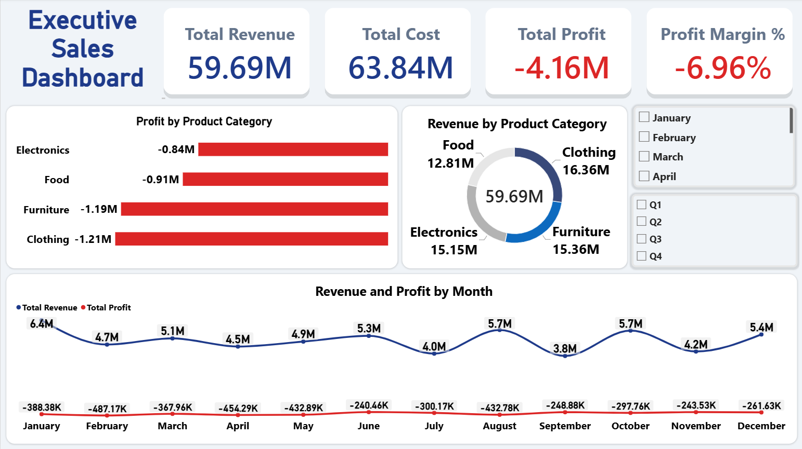
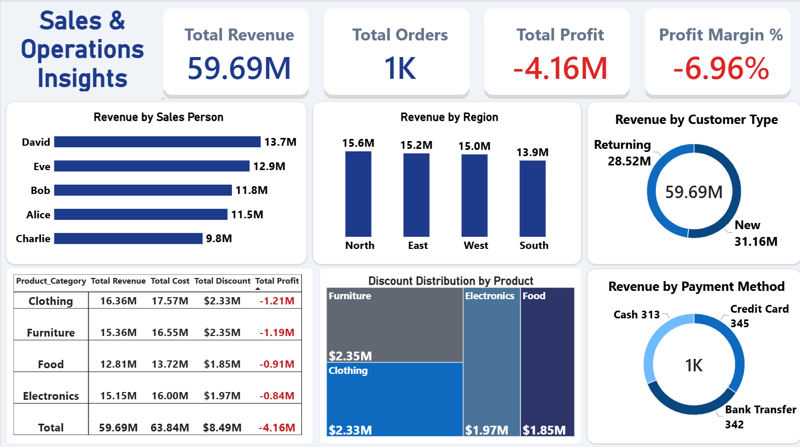
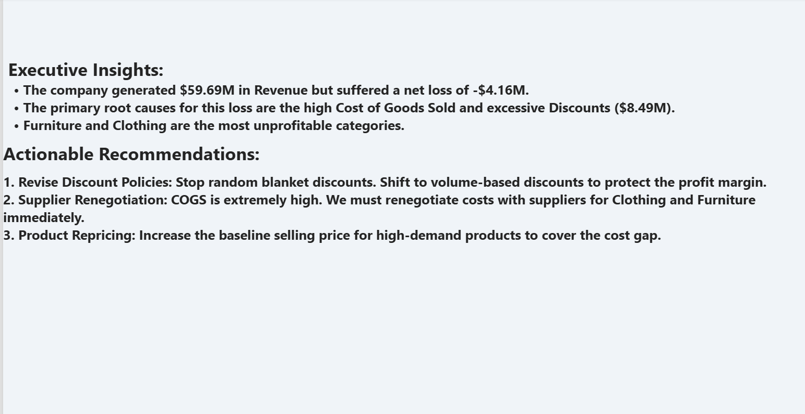

# 📊 Profitability & Sales Analysis (End-to-End Project)

## 🔗 Live Interactive Dashboard
**[View the Live Dashboard Here](https://app.powerbi.com/view?r=eyJrIjoiZmM1ZmUxNWMtZTM1Mi00YzI2LTk2MTYtYzdjNTU3MTMzM2RkIiwidCI6IjJiYjZlNWJjLWMxMDktNDdmYi05NDMzLWMxYzZmNGZhMzNmZiIsImMiOjl9)**

## 📝 Project Overview
This project presents an end-to-end Enterprise Data Analysis of a retail company's sales performance. The primary objective is to uncover the root causes of financial bleed and provide data-driven, actionable recommendations to executive management. 

Despite generating significant revenue, the company was suffering from a negative profit margin. By combining SQL for robust data processing and Power BI for strategic KPI tracking, this project transitions the narrative from "How much did we sell?" to "Why are we losing money?".

## 🛠️ Technical Skills & Tools Demonstrated
- **SQL:** Data Quality Checks (Null value handling), Data Cleaning, and creating optimized Views (`VW_Cleaned_Sales`) to calculate Gross Sales, Net Sales, Total Cost, and Total Profit.
- **Power BI:** Advanced UI/UX design, Sync Slicers, interactive visuals (Treemap, Donut, Clustered Columns).
- **DAX (Data Analysis Expressions):** Engineered over 15 dynamic measures to track core business KPIs.
  - **Financial Metrics:** `Total Revenue`, `Total Cost`, `Total Profit`, `Total Discount`, `Profit Margin %`.
  - **Time Intelligence:** Implemented complex context filtering for `Current Month Sales`, `Previous Month Sales`, `Current/Previous Quarter Sales`, and `Growth Month/Quarter Sales %`.
  - **Operational Metrics:** `AOV (Average Order Value)`, `Total Orders`, `Loss Transactions`, and `Total Loss`.
  - **Context Functions:** Applied `SUMX` for accurate row-by-row discount distributions (`Net_Sales * Discount`) across different filter contexts.
- **Business Acumen:** Translating raw data into an Executive Action Plan.

## 📂 Repository Contents
- `Sales_Data.sql`: Contains all SQL queries used for data extraction, cleaning, and exploratory data analysis (EDA).
- `sales_data.csv`: The raw dataset used for this analysis.
- `Profitability-and-Sales-Analysis.pbix`: The complete Power BI project file.
- `README.md`: Project documentation and executive summary.

## 💡 Key Executive Insights
1. The company generated **$59.69M** in Revenue but suffered a net loss of **-$4.16M**.
2. The primary root causes for this loss are the remarkably high Cost of Goods Sold (**$63.84M**) and excessive Discounts (**$8.49M**).
3. `Furniture` and `Clothing` are the most unprofitable categories, draining the highest amount of discounts.

## 🚀 Actionable Recommendations
Based on the analysis, the following strategic actions were recommended to the management:
1. **Revise Discount Policies:** Stop random blanket discounts. Shift to volume-based discounts to protect the profit margin.
2. **Supplier Renegotiation:** COGS is extremely high. We must renegotiate costs with suppliers for Clothing and Furniture immediately.
3. **Product Repricing:** Increase the baseline selling price for high-demand products to cover the cost gap.

## 📸 Dashboard Snapshots

### 1. Executive Summary View
*(High-level overview of revenue, cost, and overall profit margin)*

### 2. Sales & Operations Insights
*(Deep dive into discount distributions and regional performance)*

### 3. Action Plan & Recommendations
*(Executive memo detailing business solutions)*

